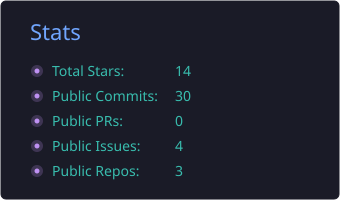
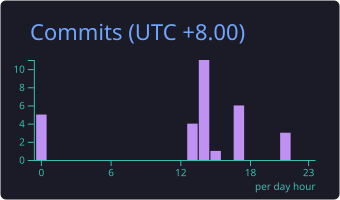
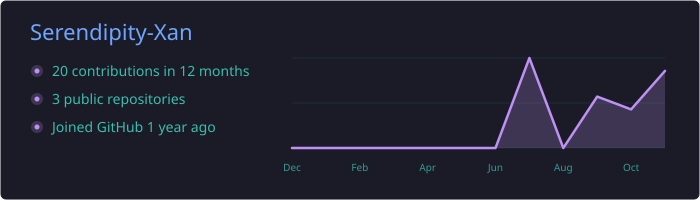
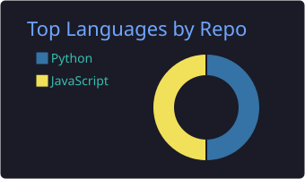
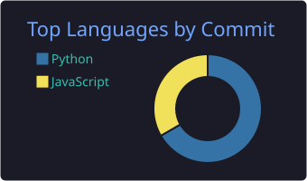

<h1 align="center">Hi, I'm ZYX</h1>

  <strong>Developer</strong> · Go · Automation &amp; Tooling

 

  
  
  <!-- 想加邮箱 / LeetCode，照上面这行的格式改链接和文字即可 -->
  <!--  -->

---
## Tech Stack

  
  
  
  
  
  
  
  
  
  
  
  
  

## GitHub Snapshot

  
  

## GitHub Summary

  

  
  

## Contribution Snake

  <picture>
    <source media="(prefers-color-scheme: dark)" srcset="https://raw.githubusercontent.com/Serendipity-Xan/Serendipity-Xan/output/github-contribution-grid-snake-dark.svg" />
    <source media="(prefers-color-scheme: light)" srcset="https://raw.githubusercontent.com/Serendipity-Xan/Serendipity-Xan/output/github-contribution-grid-snake.svg" />
    
  </picture>

---

  Keep building. Keep learning.

---
